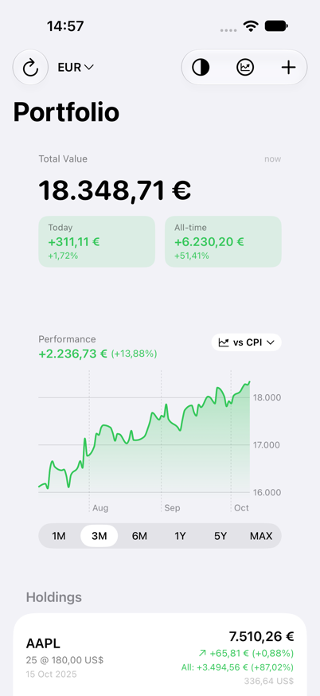
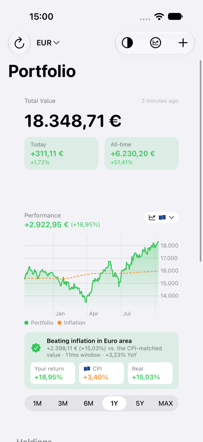
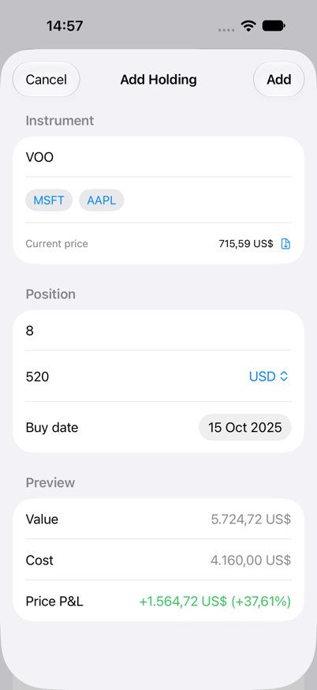
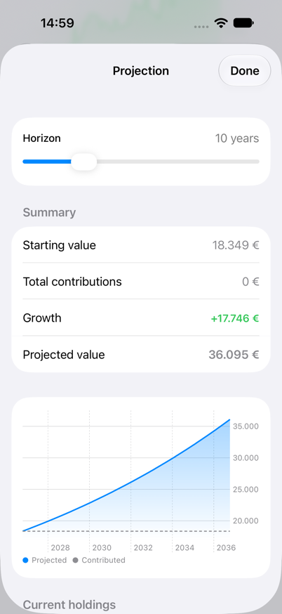
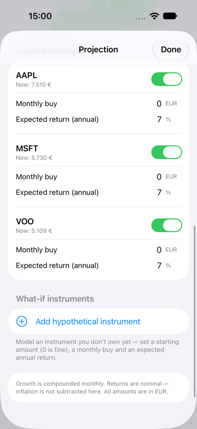
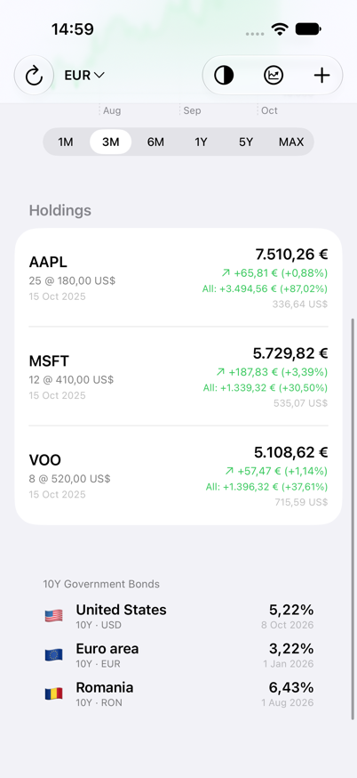
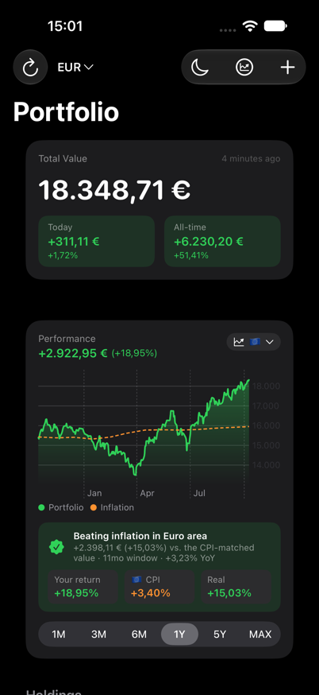

# Portofolio Tracker

A SwiftUI iOS app for tracking an investment portfolio: live prices, performance vs. inflation, government bond yields, and long-term projections.

## Screenshots

| Portfolio | vs. Inflation | Add Holding |
| --- | --- | --- |
|  |  |  |

| Projection | Projection Inputs | Holdings & Bonds |
| --- | --- | --- |
|  |  |  |

| Dark Mode |
| --- |
|  |

## Features

- Holdings with daily and all-time P&L, in multiple currencies
- Performance chart (1M → MAX) compared against CPI inflation
- 10Y government bond yields (US, Euro area, Romania)
- Portfolio growth projection with monthly contributions
- Light / dark / system appearance

## Data sources

- Prices & ticker search: Yahoo Finance
- Exchange rates: [Frankfurter](https://www.frankfurter.app)
- Inflation & US yields: [FRED](https://fred.stlouisfed.org)
- Euro-area yields: [ECB Data Portal](https://data.ecb.europa.eu)

## Setup

1. Get a free FRED API key: https://fred.stlouisfed.org/docs/api/api_key.html
2. Copy `Secrets.example.swift` to `PortofolioWidget/Secrets.swift` and paste your key.
3. Open `PortofolioWidget.xcodeproj` in Xcode and run.
